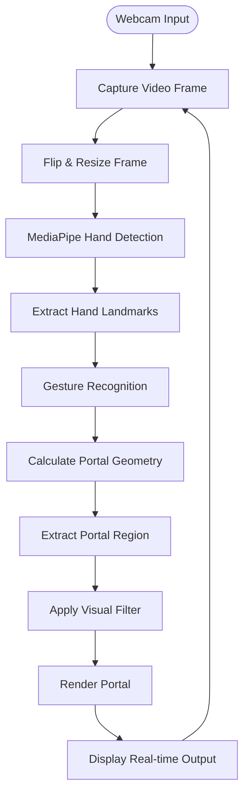

# 🖐️ RetroLens — Real-time Hand Gesture Portal Filter

<p align="center">
  
</p>

<p align="center">
  <strong>A real-time visual effects application that transforms your webcam into an interactive portal using hand gestures.</strong>
</p>

<p align="center">
  
  
  
  
  
</p>

---

## 📖 About The Project

**RetroLens** is a real-time hand gesture-based visual effects application built with Python, OpenCV, MediaPipe, and NumPy.

The application uses a webcam to detect hand landmarks and create a virtual portal between your hands. The area inside the portal is transformed using different visual effects, creating an interactive camera experience without requiring physical input devices.

Instead of switching filters manually, users can control the application through simple hand gestures.

### ✨ What Makes It Interesting?

- 🖐️ Hand gesture-based interaction.
- 🌀 Real-time visual effects inside a virtual portal.
- 🎨 Multiple image filters.
- 🔄 Interactive 2D and 3D portal modes.
- 📷 Live webcam processing.
- ⌨️ Keyboard shortcuts for additional controls.

> **This repository is a fork of the original RetroLens project by SyahdanFX, with compatibility updates for Python 3.13+ and the newer MediaPipe Tasks API.**

---

## 🎬 How It Works

RetroLens detects hand landmarks through the webcam and uses selected hand positions to calculate the portal geometry.

The image inside the detected portal is then processed using the selected visual filter.



### Processing Pipeline

| Stage               | Description                                                  |
| ------------------- | ------------------------------------------------------------ |
| Webcam Input        | Captures live video from the camera                          |
| Hand Detection      | Detects up to two hands using MediaPipe HandLandmarker       |
| Landmark Tracking   | Extracts 21 hand landmarks                                   |
| Gesture Recognition | Detects pinch and fist gestures                              |
| Portal Geometry     | Calculates the portal shape based on hand positions          |
| Image Processing    | Applies the selected filter to the portal region             |
| Rendering           | Combines the processed region with the original camera frame |

---

## ✨ Features

| Feature                | Description                                      |
| ---------------------- | ------------------------------------------------ |
| 🖐️ Hand Tracking      | Real-time hand landmark detection                |
| 🌀 Virtual Portal      | Creates an interactive visual area between hands |
| 🎨 Multiple Filters    | Includes 11 built-in visual effects              |
| 🔄 2D Mode             | Supports Quad and Bowtie portal geometry         |
| 🧊 3D Mode             | Creates a dual-surface portal using both hands   |
| 🤏 Pinch Gesture       | Switches the active visual filter                |
| ✊ Dual Fist Gesture    | Toggles between 2D and 3D mode                   |
| ⌨️ Keyboard Controls   | Allows manual control of filters and modes       |
| 📸 Screenshot          | Saves the current processed frame                |
| ⚡ Real-time Processing | Processes webcam frames continuously             |

---

## 🎨 Available Filters

RetroLens includes 11 visual effects that can be applied to the portal area.

| No. | Filter       | Description                                       |
| --: | ------------ | ------------------------------------------------- |
|  01 | Dual Tone    | Converts the image into a two-color effect        |
|  02 | Thermal      | Applies a thermal-style color map                 |
|  03 | Sketch       | Creates a pencil sketch effect                    |
|  04 | Pixelate     | Produces a pixelated visual effect                |
|  05 | Glitch       | Adds digital distortion and RGB shifting          |
|  06 | Invert       | Inverts image colors                              |
|  07 | Red Channel  | Displays only the red color channel               |
|  08 | Edge         | Highlights image edges                            |
|  09 | Blur         | Applies Gaussian blur                             |
|  10 | Cartoon      | Creates a cartoon-style appearance                |
|  11 | Rainbow Wave | Blends the image with an animated rainbow pattern |

---

## 🖐️ Gesture & Keyboard Controls

RetroLens supports both hand gestures and keyboard shortcuts.

### Hand Gesture Controls

| Gesture                  | Function                              |
| ------------------------ | ------------------------------------- |
| ✋ Extend both hands      | Creates the portal between your hands |
| 🤏 Pinch thumb and pinky | Switches to the next filter           |
| ✊ Close both fists       | Toggles between 2D and 3D mode        |

The portal geometry also responds to hand orientation, allowing the application to select different 2D shapes.

### Keyboard Controls

| Key | Function            |
| --- | ------------------- |
| `C` | Toggle 2D / 3D mode |
| `N` | Next filter         |
| `P` | Previous filter     |
| `S` | Save screenshot     |
| `Q` | Quit application    |

**Screenshot output:** Images are saved in the current working directory using the filename format:

```text
cap_<timestamp>.png
```

---

## 🧊 Portal Modes

RetroLens provides two different portal rendering modes.

### 1. 2D Mode

The default mode creates a two-dimensional portal based on hand landmark positions.

It supports two geometry variations:

- **2D Quad:** A quadrilateral portal.
- **2D Bowtie:** An alternative portal geometry based on hand orientation.

### 2. 3D Mode

The 3D mode creates two connected portal surfaces using both hands.

Each surface can use a different filter:

- First surface: Active filter.
- Second surface: Next filter in the filter sequence.

This creates a more dynamic visual effect compared to the standard 2D mode.

---

## 🔧 Changes From The Original Project

This repository is based on the original RetroLens project by **SyahdanFX**.

The main purpose of this fork is to update the hand detection implementation so the project can work with newer MediaPipe versions and Python 3.13+.

### Improvements in this fork

| Component            | Original Approach              | Fork Implementation         |
| -------------------- | ------------------------------ | --------------------------- |
| Hand Detection       | Legacy `mp.solutions` API      | MediaPipe Tasks API         |
| Hand Tracking        | Legacy hand tracking solution  | `HandLandmarker`            |
| Landmark Drawing     | MediaPipe drawing utilities    | Manual drawing using OpenCV |
| Dependency           | Older MediaPipe implementation | `mediapipe==1.2.3`          |
| Python Compatibility | Older environment              | Updated for Python 3.13+    |

### What Remains The Same?

The following core features are retained:

- Visual filter collection.
- Portal rendering logic.
- Hand gesture controls.
- 2D and 3D modes.
- Keyboard shortcuts.
- Real-time webcam processing.

The goal is to preserve the original experience while updating the underlying hand detection implementation.

---

## 🛠️ Tech Stack

| Technology              | Purpose                                        |
| ----------------------- | ---------------------------------------------- |
| **Python 3.13+**        | Main programming language                      |
| **OpenCV**              | Webcam access, image processing, and rendering |
| **MediaPipe Tasks API** | Real-time hand landmark detection              |
| **NumPy**               | Numerical operations and image manipulation    |

### Dependencies

Dependencies are defined in `requirements.txt`:

```text
mediapipe==1.2.3
numpy
opencv-contrib-python
```

> **Important:** Do not install `opencv-python` alongside `opencv-contrib-python` in the same environment because both packages provide the `cv2` module and may conflict.

---

## 📁 Project Structure

```text
Retrolens/
│
├── 📄 Retrolens.py
│   └── Main application and image processing pipeline
│
├── 📄 requirements.txt
│   └── Python dependencies
│
├── 📄 LICENSE
│   └── MIT License and copyright notices
│
├── 📄 README.md
│   └── Project documentation
│
├── 📄 .gitignore
│   └── Excluded files and local development artifacts
│
└── 📦 hand_landmarker.task
    └── MediaPipe model file (download separately)
```

> The `hand_landmarker.task` model is intentionally not included in the repository. Download it separately before running the application.

---

## ⚙️ Installation & Setup

### Prerequisites

Before installing RetroLens, make sure you have:

- Python **3.13 or newer**.
- A working webcam.
- An internet connection for installing dependencies and downloading the model.
- Windows, macOS, or Linux environment.

**Compatibility note:** This fork has been tested on Windows with Python 3.13. macOS and Linux have not yet been tested.

### 1. Clone Repository

```bash
git clone https://github.com/herdiansyahdp/Retrolens.git
```

Enter the project directory:

```bash
cd Retrolens
```

### 2. Create Virtual Environment

Creating a virtual environment is recommended to keep project dependencies isolated.

```bash
python -m venv venv
```

### 3. Activate Virtual Environment

**Windows PowerShell:**

```powershell
.\venv\Scripts\Activate.ps1
```

**macOS / Linux:**

```bash
source venv/bin/activate
```

### 4. Install Dependencies

Upgrade pip:

```bash
python -m pip install --upgrade pip
```

Install the required packages:

```bash
python -m pip install -r requirements.txt
```

> Do not manually install `opencv-python` when `opencv-contrib-python` is already installed through the requirements file.

---

## 📦 Download MediaPipe Model

RetroLens requires the `hand_landmarker.task` model file to perform hand detection.

The model must be placed in the same directory as `Retrolens.py`.

### Windows PowerShell

```powershell
curl.exe -L -o hand_landmarker.task "https://storage.googleapis.com/mediapipe-models/hand_landmarker/hand_landmarker/float16/latest/hand_landmarker.task"
```

### macOS / Linux

```bash
curl -L -o hand_landmarker.task "https://storage.googleapis.com/mediapipe-models/hand_landmarker/hand_landmarker/float16/latest/hand_landmarker.task"
```

Alternatively, open the following URL in your browser and download the model manually:

[Download hand_landmarker.task](https://storage.googleapis.com/mediapipe-models/hand_landmarker/hand_landmarker/float16/latest/hand_landmarker.task)

After downloading, make sure your project directory looks like this:

```text
Retrolens/
│
├── Retrolens.py
├── requirements.txt
├── hand_landmarker.task
└── LICENSE
```

---

## 🚀 Running The Application

After completing the installation and downloading the model, run:

```bash
python Retrolens.py
```

The application will:

1. Initialize the MediaPipe HandLandmarker.
2. Access the webcam.
3. Detect hand landmarks in real time.
4. Recognize gestures.
5. Render the selected portal effect.
6. Display the output in the RetroLens Engine window.

Press `Q` to close the application.

---

## ⚙️ Configuration

The application uses the `PipelineConfig` dataclass to configure the camera and processing parameters.

```python
@dataclass
class PipelineConfig:
    cam_index: int = 0
    frame_width: int = 960
    frame_height: int = 540
    pinch_threshold_px: float = 45.0
    filter_cooldown_sec: float = 0.15
    mode_cooldown_sec: float = 1.2
    fist_dist_threshold_px: float = 80.0
```

| Parameter                | Default | Description                            |
| ------------------------ | ------: | -------------------------------------- |
| `cam_index`              |     `0` | Webcam device index                    |
| `frame_width`            |   `960` | Processing frame width                 |
| `frame_height`           |   `540` | Processing frame height                |
| `pinch_threshold_px`     |  `45.0` | Distance threshold for pinch detection |
| `filter_cooldown_sec`    |  `0.15` | Delay between filter switches          |
| `mode_cooldown_sec`      |   `1.2` | Delay between mode switches            |
| `fist_dist_threshold_px` |  `80.0` | Threshold for detecting closed fists   |

You can modify these values in `Retrolens.py` to adjust the behavior of the application.

---

## 🛠️ Troubleshooting

### 1. Model Not Found

If the application displays:

```text
[ERROR] Model tidak ditemukan
```

Make sure `hand_landmarker.task` exists in the same directory as `Retrolens.py`.

### 2. Camera Not Detected

If the webcam cannot be opened:

- Make sure the webcam is connected and available.
- Close other applications using the webcam.
- Check the camera permission settings.
- Try changing `cam_index` from `0` to `1` in `PipelineConfig` if you have multiple camera devices.

### 3. OpenCV Module Conflict

If you encounter issues with the `cv2` module, check whether both `opencv-python` and `opencv-contrib-python` are installed.

You can reinstall the required package:

```bash
python -m pip uninstall opencv-python opencv-contrib-python -y
python -m pip install opencv-contrib-python
```

### 4. Hand Detection Is Unstable

For better tracking results:

- Use sufficient lighting.
- Keep your hands inside the camera frame.
- Avoid excessive motion.
- Make sure the camera lens is clean.

---

## 🔭 Future Improvements

Some ideas for further development:

- 📸 Add visual screenshots and demonstration videos.
- 🎛️ Add a graphical interface for filter selection.
- ⚡ Improve frame processing performance.
- 🎨 Add more visual effects and customization options.
- 🖐️ Improve gesture recognition and interaction.
- 📷 Add camera selection through the interface.
- 🧩 Improve cross-platform compatibility.

---

## 📜 Credits & License

### Original Project

RetroLens was originally created by **SyahdanFX**.

Original repository:

[syahdanfx/Retrolens](https://github.com/syahdanfx/Retrolens)

This repository is a fork that contains compatibility updates and implementation changes for newer MediaPipe APIs.

Special thanks to the original author for creating and sharing the project.

### License

This project includes the **MIT License**. See the [`LICENSE`](LICENSE) file for the complete license terms and copyright notices.

Please retain the original copyright and license notices when redistributing or modifying the project.

---

## 👨‍💻 Fork Maintainer

<p align="center">
&#x20; \<strong>Herdiansyah Dwi Putra\</strong>\<br/>
&#x20; Informatics Engineering Student
</p>

<p align="center">
&#x20; \<a href="[https://github.com/herdiansyahdp](https://github.com/herdiansyahdp)">
&#x20;   \
&#x20; \</a>
</p>

<p align="center">
&#x20; \<strong>Original Author:\</strong> \<a href="[https://github.com/syahdanfx](https://github.com/syahdanfx)">SyahdanFX\</a>
</p>

---

## ⭐ Support

If you find this project interesting, consider giving the original repository a star and exploring the implementation.

This fork is part of my journey in learning Python, computer vision, and real-time image processing.

<p align="center">
  <i>Explore gestures. Create portals. See the world differently. 🌀</i>
</p>

<p align="center">
  
</p>